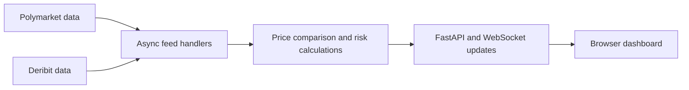

# Cross-Market Arbitrage Research

A Python research terminal for comparing related prediction-market and derivatives prices. It brings Polymarket and Deribit data into one view, evaluates candidate opportunities, and explores hedging behavior through simulation.

**Status:** live-data scanners and research simulations. This repository does not implement automated order placement.

## What it does

- Consumes Polymarket and Deribit market data through asynchronous feed handlers.
- Compares candidate prices using modeled fees, time to expiry and risk estimates.
- Adds order-book depth checks in a dedicated liquidity scanner.
- Simulates portfolio delta and perpetual-futures hedging.
- Streams calculated state to a browser dashboard through FastAPI and WebSockets.

## System overview



The main scanner runs the feed subscriptions, dashboard server and state broadcaster together with `asyncio`. A separate scanner adds liquidity checks; a separate simulator explores hedging behavior.

## Start here

| Component | Purpose |
|---|---|
| [matrix_scanner.py](matrix_scanner.py) | Main live-data scanner, calculations, REST state endpoint and WebSocket dashboard |
| [templates/dashboard.html](templates/dashboard.html) | Browser interface |
| [liquidity_scanner.py](liquidity_scanner.py) | Scanner with order-book depth checks |
| [matrix_simulator.py](matrix_simulator.py) | Delta-hedging simulation |

## Run locally

From a Python environment, install the packages imported by the scanners:

```bash
git clone https://github.com/arushg05/arb.git
cd arb
python -m pip install requests websockets fastapi uvicorn
python matrix_scanner.py
```

Open **http://127.0.0.1:8000**. The main script also attempts to open the dashboard automatically.

Alternative entry points:

```bash
python liquidity_scanner.py
python matrix_simulator.py
```

These consume live external data. Available contracts, source availability and the scanner's configured strike range affect what appears; an empty opportunity list is a possible result. Use the data providers only where access is permitted.

## Research scope

Displayed opportunities are model outputs, not completed trades or realized returns. Fill prices, liquidity, fee assumptions, contract resolution and hedging error affect whether an apparent discrepancy is tradable. This repository does not establish risk-free profitability or benchmarked production latency.

**Stack:** Python, asyncio, WebSockets, FastAPI, Uvicorn, HTML/JavaScript.
